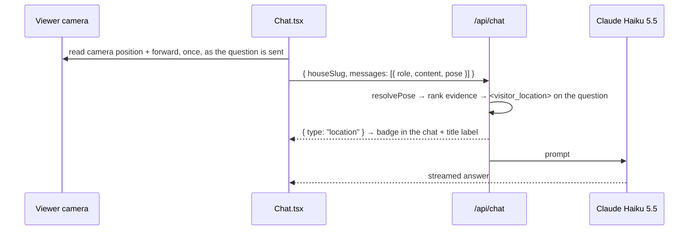

# LLM Layer

How the listing chat works: where house context lives, how the visitor's position in the 3D tour becomes a named location, and how both reach Claude.

**Current state:** one house, the Seven Park unit (`house-3`), shown as a full-screen, walk-only 3D tour with the chat floating over it. The chat is **location-aware**:
- The camera position is mapped to a **room**, and the view ray to the **object** you're facing, such as the kitchen sink, the stove or the shower.
- The direction you face picks out what "this" means.

The location is resolved when you ask, shown as a badge in the chat ("Kitchen · Sink"), and the answer uses that spot's evidence first.

## Where things live

| File | What it does |
|---|---|
| `llm/src/houses.ts` | **All house data.** `zones` (rooms and features with boxes in scene coordinates, plus `opensTo`), `scene` (3D tour URLs and credit), `facts`, and `documents` whose sections are tagged with zone IDs. |
| `llm/src/types.ts` | `House`, `HouseScene`, `Zone`, `Box`, `Vec3`, `ListingFact`, `SourceDocument`, `DocumentSection`. |
| `llm/src/spatial.ts` | **Spatial resolution.** `resolvePose()` turns a camera pose into a `ResolvedLocation`; `zoneRelevance()` scores zones for ranking evidence; `locationLabel()` makes the UI label. No data in it, so the browser can import it via `@splat/llm/spatial`. |
| `llm/src/context.ts` | `SYSTEM_PROMPT` (voice, location rules, ground rules), `buildHouseContext()` (evidence ranked by location), `formatLocation()` (the per-question location block), `sourceLabels()`. |
| `llm/src/claude.ts` | `streamChatAboutHouse()`: resolves location, builds the prompt, streams from `claude-haiku-5-5`. |
| `apps/web/src/app/api/chat/route.ts` | `POST /api/chat`: validates `{ houseSlug, messages: [{ role, content, pose? }] }` and streams NDJSON back. |
| `apps/web/src/app/house/[slug]/CameraReadout.tsx` | Zone-authoring aid, on screen for now: live x/y/z, facing (axis, degrees, compass) and Corner 1/2 → `area(...)`. Reads the camera in the browser only; no server calls. |
| `apps/web/src/app/house/[slug]/camera.ts` | `readPose()` and `heading()`, shared by the chat and the readout. |
| `apps/web/src/lib/pose.ts` | Validates poses from the browser (finite numbers within ±1000). |
| `apps/web/src/app/house/[slug]/HouseExperience.tsx` | Full-screen layout. Reads the camera pose for the chat, shows the label from the last question, and mounts the camera readout. |
| `apps/web/src/app/house/[slug]/SplatViewer.tsx` | Embeds `engine/supersplat-viewer` (`createViewer({ ui: false })`), walk-only, with a loading bar, Reset position, hint and credit. |
| `apps/web/src/app/house/[slug]/Chat.tsx` | Chat panel. Reads the pose at the moment you send, streams answers, renders citations as chips, and labels each question with where it was asked. |

## How a question gets its location

Location is worked out **only when a question is sent**. Nothing is tracked while you walk.



The badge in the chat header (and the title label) shows where you were **when you last asked**. It starts as "Ask a question to see where you are".

**Reading the pose:** the viewer has no pose API yet, so `readPose()` reads the engine entity it creates: `viewer.app.root.findByName("camera")`, using its `getPosition()` and `forward`. If the viewer ever renames that entity, this is the one line to update.

The on-screen camera readout samples the camera locally (every 100 ms, in the browser) for zone authoring. It never resolves zones or calls the server.

## Zones

Zones follow the blueprint's `spatial_zones`. Each has an `id`, `name`, `kind`, `parentId` and `aliases`, plus boxes in the scene's world coordinates (metres, y up, floor at y = 0), written `area(x0, x1, z0, z1)` in `llm/src/houses.ts`.

| Kind | Box field | What the box is |
|---|---|---|
| **room** / **outdoor_area** | `boxes` | The floor area you stand in. Several boxes make an L-shape (the primary bedroom plus its walk-in closet). |
| **entrance** | `boxes` | A doorway. Resolved by **position only**: standing in it puts you "at the entrance", whichever way you face. |
| **feature** / **appliance** | `target` | **The object itself, with its real height.** The camera's 3D view ray is cast against these. |

**`opensTo`** on a room lists the rooms you can see into (open plan or a doorway). It stands in for line-of-sight, so nothing in a room behind a wall counts. One side is enough; it's treated as symmetric.

House 3:

```text
Kitchen          → Sink, Stove (back counter); Oven range, Stove (main run), Tall cabinets; Back counter, Main counter run
Dining area      → Dining table
Living room      → TV (above) / Media shelf (below), Couch, Balcony door, Storage closet
Hallway
Second bathroom  → Shower, Toilet, Sink & mirror · Entrance
Second bedroom   → Bed, TV (above) / Dresser (below), Nightstand, Closet, Balcony door · Entrance
Primary bedroom  → Bed, TV (above) / Dresser (below), Nightstand, Balcony door, Closet (incl. the walk-in closet) · Entrance
Primary bathroom → Shower, Toilet, Sink & mirror · Doorway
Balcony          (the whole south side)
Open: kitchen–dining–living–balcony, dining/living–hallway–second bedroom & bathroom,
      living–primary bedroom–primary bathroom, both bedrooms–balcony
```

**Where the boxes came from:**
- **Room boxes:** read off the scene's walk-mode collision data (`scene.voxel.json` / `.bin`, a sparse voxel tree at 5 cm), decoded and drawn as a top-down height map of walls, counters and furniture.
- **Object boxes:** from a walkthrough log made with the camera readout. Each line is a position, a heading and "<thing> in <room>". Each logged view ray was cast across the collision voxels, and the target box sits on the object it hit (a 0.95 m counter, a 0.6 m TV console, a 0.1 m shower tray…). Objects logged at the same spot but looking up vs down ("TV" / "Shelf") became two stacked objects split by height, using the voxel heights there (the shelf top is ≈ 0.75 m, the TV is above it). The logger now records pitch too, so future logs capture up/down.
- **Entrance boxes:** sit on the logged doorway positions.

Replaying the 32-line log through the 3D resolver (the log predates pitch logging, so each entry is swept from +15° to −60°): **31 entries reach the object they name** at a natural tilt. The other one stands in the primary bathroom's doorway while labelled "in primary bedroom", and resolves to "Primary bathroom · Doorway → Closet". A relog with pitch (the logger now records it) checks each at its real angle.

## Resolution (`resolvePose`)

Two independent answers:

1. **Where you are, from the camera's x/z position:**
   - the **entrance** whose doorway box you're in;
   - else the smallest **room** box containing you;
   - else the nearest room within 1.5 m (`near-zone`);
   - else `unknown`: the model asks which area you mean rather than guessing.
2. **What you're facing, from the camera's 3D view ray** (heading **and** tilt): the **first object box the ray hits**, within 8 m, among objects in rooms visible from yours (`opensTo`).
   - If two boxes are hit within 15 cm of each other, the **smaller wins**, so the sink beats the counter it's set into.
   - **If the ray hits nothing** (bare wall, ceiling, floor), the **closest object to where you're standing** stands in, preferring your own room, within 2.5 m. It's marked `facingBy: "nearest"` so the model treats it as a hint, not "this".

Then **nearby**: other objects within 1 m, or within a ±35° cone and 8 m.

**Every object has its real height** (`obj(x0, x1, z0, z1, bottom, top)`), so what you face depends on where you look, like in the room:
- **Looking level** (eye ≈ 1.55 m) you see what's at eye height: upper cabinets, tall cabinets, the oven range, closets, TVs, mirrors, showers, balcony glass. You also look **over** low things to what's behind them (over the second bedroom's bed to its closet).
- **Looking down** gives low things:

  | Object | Tilt needed |
  |---|---|
  | Beds, couch | about −20° |
  | Dining table, kitchen sink | about −25° |
  | Stoves | −30° to −35° |
  | Toilets | about −35° |
  | Shelf or dresser under a TV | about −40° |
  | Nightstands | about −40° |
- **Kitchen runs** are two boxes each: base and counter to 1.0 m, and shallower upper cabinets from 1.45 m. So a downward look passes under the uppers to the sink or stove.

```ts
// kitchen aisle, facing +z, 35° down
{ primaryZone: Kitchen, facingZone: Sink, facingBy: "ray", nearbyZones: [Back counter, Stove (back counter), ...],
  confidence: 0.9, resolution: "inside-zone" }   // label: "Kitchen → Sink"
```

**UI label:** where you are → what you're facing. Examples: "Kitchen → Sink", "Second bathroom · Entrance → Shower", and "Living room · near Couch" when the ray hit nothing.

## Ranking evidence

`buildHouseContext(house, location)` builds `<evidence>`:
1. **Whole-home facts:** always included.
2. **"Where the visitor is now":** sections for relevant zones, scored as follows, best first:
   - **1.0** for the object you're facing.
   - **0.9** for the room you're in, and everything in it.
   - **0.8** for the room around a doorway you're standing in.
   - **0.7** for things in view.
3. **"Elsewhere in the home":** everything else, so whole-home questions work from anywhere.

Each section ends with its source label in brackets, the same shape as the facts lines. Putting the label in the heading led the model to cite the heading.

## What the model sees

The latest question starts with:

```text
<visitor_location>
In: Kitchen (room)
Facing: Sink
Also in view: Back counter, Stove (back counter)
Location confidence: high
</visitor_location>
```

When the ray hits nothing, the `Facing:` line becomes `Nearest object (not looking at anything in particular): Couch`.

Earlier questions get a one-line version (`Was standing at: Sofa (Living room)`). The prompt's location rules:
- Use the location only to interpret "here", "this" and "that". "Facing" is what "this" most likely means.
- Answer "this" questions from that area's evidence, never borrowing from another room.
- Don't mention where they are unless the question is about it.
- Go by the latest question's location.
- When it's unknown, answer about the whole home, and only ask which area when a question needs it.

## Tested behaviour (real API, poses from the walkthrough log)

| Where | Question | Answer |
|---|---|---|
| Kitchen aisle, 35° down at the sink | "What is this?" | The undermount sink on the back counter, dishwasher beside it. |
| Same spot, looking level | "What is this?" | The back counter and its upper cabinets. |
| Second bedroom, level over the bed | "What's that over there?" | "You're looking at the closet… along the wall behind the bed." |
| Back counter, facing the stove | "What kind of stove is this?" | 30-inch induction stovetop with a hood. |
| Living room TV spot, looking level | "What is this?" | The TV wall, "hanging above the media shelf". |
| Same spot, looking down | "What is this?" | The floating media shelf below the TV. |
| At the back-counter stove | "Is there a second stove?" | Yes, on the main run beside the oven range. |
| Second bathroom, facing the shower | "What's the shower like?" | Glass-enclosed shower. |
| Bathroom doorway, facing the closet | "Tell me about this" | The walk-in closet. |
| Second bedroom, facing the balcony door | "Can I walk out there?" | Yes, its own sliding door to the balcony. |
| At the couch | "Is this included?" | No, it's virtual staging. |
| Primary bedroom doorway | "Where am I?" | "By the entrance, with the bed in front of you". |

## Checking and editing zones

The tour page shows a **camera readout** under the title. It's on for now while zones are mapped by hand; close it with ×.
- **Position:** x / y / z, in the same coordinates as the zone boxes.
- **Pitch:** camera tilt (positive = up), shown and logged, because it decides stacked objects like a TV over a shelf.
- **Facing:** the axis you face ("+x −z"), the heading in degrees (0° = +z, 90° = +x), the raw forward vector, and a compass drawn top-down like the zone map (+x right, +z down).
- **Log:** type an optional description and click Log (or press Enter) to record x/y/z, heading, axis and the description. **Download .txt** exports the log; **Undo last** and **Clear** edit it. The log is kept in this browser's local storage, so it survives refreshes.
- **Copy x, z** copies `[x, z]`.
- **Corner 1 / Corner 2** gives a ready-to-paste `area(x0, x1, z0, z1)`. Stand at one corner of the area, click Corner 1, walk to the opposite corner, click Corner 2, then click the `area(...)` button to copy it.

To fix or add a zone:
1. Use Corner 1 / Corner 2 to get its `area(...)`.
2. Put it in the zone's `boxes` in `llm/src/houses.ts`. A new zone also needs an `id`, `name`, `kind` and, for a feature, `parentId`; a new room may need `opensTo`.
3. If it's a new feature, add a document section tagged with its zone ID, so "this" has something to answer from.

To check where a spot resolves, ask a question there: the chat badge shows the zone it was placed in.

## Listing content (House 3)

All fictional. Each document is a source the model cites (chips in the chat), and every section is tagged with the zones it's about, so "this" questions pull the right one.

| Source | What's in it |
|---|---|
| Listing facts | Price, beds/baths, 960 sq ft interior, 110 sq ft balcony, year, parking, HOA, countertops, appliance package. |
| Realtor amenities form | Room-by-room and object-by-object descriptions, a staging note (furniture isn't included), the layout. |
| **Floor plan & dimensions** | Room sizes and object sizes, from the zone boxes, so they match the 3D scene. Examples: kitchen 12′6″ × 8′8″, primary bedroom 11′6″ × 12′8″ (fits a king), 60″ double vanity, 60 × 36″ shower. |
| **Appliance & fixture schedule** | Makes and product lines: Bosch Benchmark and Miele 30″ induction cooktops, a Bosch 800 Series wall oven and dishwasher, a Kraus sink, a Kohler faucet, Hansgrohe/Kohler/TOTO/Grohe bath fixtures, Lutron shades, a Carrier heat pump. **Product-line names only, no SKUs or model numbers**, so no invented specs get pinned on a real product. |
| HOA documents, seller disclosure, neighborhood guide | Fees and rules, systems and warranty, nearby distances. |

## Citations, streaming and context switching

- **Citations:** the model ends factual sentences with `[Source label]`, and `Chat.tsx` turns those into chips. Only this house's real labels count (`sourceLabels(house)`).
- **Streaming:** `/api/chat` returns NDJSON events:
  - `location` (sent first);
  - `text` (append) and `replace` (swap the whole answer);
  - then `done` or `error`.

  Request errors are JSON with a 4xx status.
- **Context switching:** Claude remembers nothing between requests. Each request carries one house's evidence, ranked for that question's location. History lives in the browser. The client sends only a house name and poses; the server picks the evidence. Edits to `houses.ts` apply to the next question.
