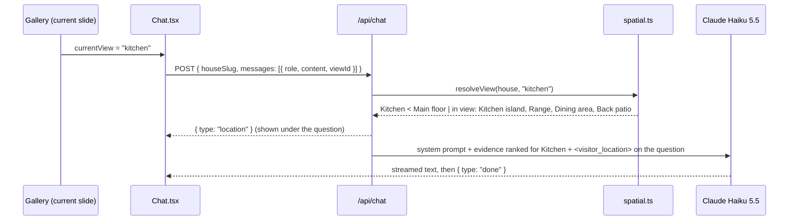

# LLM Layer

How the listing chat works: where house context lives, how the visitor's location is worked out, and how both reach Claude.

**Spatial context today:** the 3D engine isn't ready, so each house has a photo slideshow. The photo the visitor is looking at stands in for the camera position. The app works out which zone (room or feature) that photo shows, and the chat uses it to answer "this room" questions. When the engine lands, only the "camera → zone" step changes (see [Swapping in the 3D engine](#swapping-in-the-3d-engine)).

## Where things live

| File | What it does |
|---|---|
| `llm/src/houses.ts` | **All house data.** Per house: `zones` (named areas), `views` (slideshow photos, each mapped to a zone), `facts`, and `documents` whose sections are tagged with zone IDs. |
| `llm/src/types.ts` | `House`, `Zone`, `HouseView`, `ListingFact`, `SourceDocument`, `DocumentSection`, mirroring the blueprint's tables. |
| `llm/src/spatial.ts` | **Spatial resolution.** `resolveView()` turns a view into a `ResolvedLocation`; `zoneRelevance()` scores zones for ranking evidence. |
| `llm/src/context.ts` | `SYSTEM_PROMPT` (voice, location rules, ground rules), `buildHouseContext()` (evidence ranked by location), `formatLocation()` (the per-message location block), `sourceLabels()`. |
| `llm/src/claude.ts` | `streamChatAboutHouse()`: resolves location, builds the prompt, streams from `claude-haiku-5-5`. |
| `apps/web/src/app/api/chat/route.ts` | `POST /api/chat`: validates the request and streams NDJSON back. |
| `apps/web/src/app/house/[slug]/page.tsx` | House page (server). Passes only photos, title and source labels to the client. Facts, documents and zones never reach the browser. |
| `apps/web/src/app/house/[slug]/HouseExperience.tsx` | Holds the current slide, shared by the gallery and the chat. |
| `apps/web/src/app/house/[slug]/Gallery.tsx` | Photo slideshow: arrows, thumbnails, ←/→ keys. Stand-in for the 3D viewer. |
| `apps/web/src/app/house/[slug]/Chat.tsx` | Chat panel. Sends the current view with each question, shows "Viewing: …", renders citations as chips. |
| `apps/web/public/houses/` | Photos. House 1 has five, in `house-1/`. |

## Request flow



1. The visitor picks a slide. `HouseExperience` gives its `id` to the chat.
2. Each question is sent with the `viewId` it was asked from. Earlier turns keep their own `viewId`.
3. The server resolves the **latest** question's view to a location: the zone they're in, its parent zones, and the zones in view.
4. The evidence is re-ranked for that location and the location is attached to the question (details below).
5. The answer streams back. The first event tells the chat panel where the server placed the question, which it shows as "in Kitchen" under the question.

## Spatial context

### Zones and views

Zones follow the blueprint's `spatial_zones`, minus the bounding boxes for now. Each has an `id`, `name`, `kind` (`room`, `feature`, `appliance`, `floor`, `outdoor_area`), an optional `parentId`, and `aliases`. House 1:

```text
Whole property
├─ Exterior & garage             ← "Exterior" slide
├─ Back patio
├─ Main floor
│  ├─ Kitchen                    ← "Kitchen" slide (in view: island, range, dining, patio)
│  │  ├─ Kitchen island
│  │  └─ Range
│  ├─ Dining area
│  └─ Living room                ← "Living room" slide
└─ Upper floor
   ├─ Primary bedroom            ← "Primary bedroom" slide (in view: primary bathroom)
   ├─ Primary bathroom
   ├─ Hall bathroom              ← "Hall bathroom" slide (in view: second bedroom)
   └─ Second bedroom
```

Each **view** (slide) has a `zoneId` (where the visitor is) and `visibleZoneIds` (what else is clearly in the photo). Document sections list the zones they're about in `zones`. An empty list means the section covers the whole home, like the HOA rules or the neighborhood guide.

### Resolution (`spatial.ts`)

`resolveView(house, viewId)` returns the blueprint's `ResolvedLocation`:

```ts
{
  primaryZone: { id: "kitchen", name: "Kitchen", kind: "room" },
  ancestorZones: [{ name: "Main floor" }],                       // innermost first
  nearbyZones: [{ name: "Kitchen island" }, { name: "Range" }, ...],
  confidence: 1,                                                 // views are hand-authored
  resolution: "inside-zone"                                      // or "unknown"
}
```

This is plain code, not the model, so it's deterministic and testable. An unknown or missing `viewId` returns `resolution: "unknown"`, and the model then asks which room the visitor means rather than guessing.

### Ranking evidence

`buildHouseContext(house, location)` builds the `<evidence>` block:

1. **Listing facts:** always included, whatever the location. Structured facts beat document text.
2. **"Where the visitor is now":** document sections tagged with a relevant zone, best first. `zoneRelevance()` scores each zone:
   - **1.0** for the zone they're in, or anything inside it. In the Kitchen, that includes the island and range.
   - **0.7** for zones in view from there.
   - **0.3** for containing zones, like Main floor.
3. **"Elsewhere in the home":** everything else, so general questions still work from any room.

Every section is still sent, because the data is small; location only decides order and grouping. With many documents this becomes real retrieval with the same zone scoring (blueprint § "Retrieval ranking").

### What the model sees

The latest question starts with a location block (blueprint § "Example answer context"):

```text
<visitor_location>
Currently viewing: Kitchen (room)
Within: Main floor
Also in view: Kitchen island, Range, Dining area, Back patio
Location confidence: high
</visitor_location>

What are these counters made of?
```

Earlier questions get a short version, `<visitor_location>Was viewing: Living room</visitor_location>`, so the model knows where "here" pointed back then.

The **location rules** in `SYSTEM_PROMPT` (from the blueprint's system-instruction requirements):
- Use the location only to interpret "here", "this room", "these counters" and "that appliance". It isn't a fact about the home.
- Answer "this room" questions from the "Where the visitor is now" evidence. If that evidence doesn't cover it, say so rather than borrowing from another room.
- Questions about other rooms or the whole home are answered normally, without implying the visitor is somewhere they're not.
- Always go by the latest message's location.
- If the location is unknown, ask which area.
- It can't see the photos, so it never describes what's in a picture beyond the evidence.

### Tested behavior

| Asked from | Question | Result |
|---|---|---|
| Kitchen | "What are these counters made of?" | White quartz, kitchen and island. Cited. |
| Primary bedroom | same | Took "these counters" as the in-view en-suite vanity; said its material isn't listed; mentioned the kitchen's quartz without implying the visitor is in the kitchen. |
| Kitchen, then Primary bedroom | "What appliances are in here?", then "And what about in here?" | Switched to describing the bedroom. |
| Unknown view | "Tell me about this room" | Asked which room the visitor means. |
| Living room | "What's that painting on the wall?" | Said artwork isn't in the listing; suggested asking the agent. |
| Exterior | "How many bedrooms?" | 3. A whole-home answer from any location. |

## How context switching works

Claude remembers nothing between requests. Every request carries exactly one house's evidence, ranked for that request's location.

- **Changing houses:** the next request names a different `houseSlug`, so only that house's data is sent.
- **Changing rooms:** the next question carries a different `viewId`, so the evidence is re-ranked and a new location block is attached.
- **History lives in the browser** (React state in `Chat.tsx`). The server is stateless.
- **Each house starts a fresh chat** (`<HouseExperience key={house.slug}>`), and a page refresh clears it.
- **The client can't inject context.** It sends a house name and a view ID; the server picks the evidence and works out the location. An unrecognized view ID just means "location unknown".
- **Edits are live.** Changes to `houses.ts` apply to the next question.

## Citations and source chips

The model ends each factual sentence with a source label in brackets, e.g. `The island seats four. [Realtor amenities form]`. `Chat.tsx` (`splitCitations`) removes those from the text and shows them as chips under the answer. Only this house's real labels count (`sourceLabels(house)`: fact sources plus document titles); other bracketed text is left alone. While streaming, a half-written `[Rea…` is hidden until it closes.

## Streaming protocol

`POST /api/chat`:

```json
{
  "houseSlug": "house-1",
  "messages": [{ "role": "user", "content": "What are these counters made of?", "viewId": "kitchen" }]
}
```

Request errors (unknown house, bad body) return JSON with a 4xx status. Otherwise the response is `application/x-ndjson`, one JSON event per line:

| Event | Meaning |
|---|---|
| `{"type":"location","location":{…}}` | Sent first: the `ResolvedLocation` for the latest question. |
| `{"type":"text","text":"…"}` | Append to the answer. |
| `{"type":"replace","text":"…"}` | Replace the whole answer (refusal or empty reply). |
| `{"type":"done"}` | Finished. |
| `{"type":"error","error":"…"}` | Failed mid-stream. |

## Common changes

- **Edit what the assistant knows:** `llm/src/houses.ts`.
- **Add a slide:** put the image in `apps/web/public/houses/<house>/`, then add a `views` entry with its `zoneId` and `visibleZoneIds`. Add a zone first if the room is new.
- **Tie a document section to a room:** list the zone IDs in that section's `zones`.
- **Add a house:** add the object, with at least one view, to the `houses` array.
- **Change the tone or rules:** `SYSTEM_PROMPT` in `llm/src/context.ts`. Keep the location and ground rules.
- **Change the model:** `CHAT_MODEL` in `llm/src/claude.ts`.

## Swapping in the 3D engine

Everything after "where is the visitor?" stays the same. To switch from slides to the 3D viewer:

1. Give zones bounding boxes (`min_x … max_z`, in the viewer's world coordinates), as in the blueprint's `spatial_zones`.
2. Have the viewer send `scene.pose.v1` (position and forward vector) instead of a `viewId`.
3. Add `resolvePose(house, position)` in `spatial.ts`: find enabled zones whose box contains the point, prefer the smallest, fall back to nearby zones within about 1.5 m, otherwise `unknown`. It returns the same `ResolvedLocation`.
4. Add hysteresis in the UI so the location label doesn't flicker at doorways.

`buildHouseContext`, `formatLocation`, the prompt, the route and the chat panel all already work on a `ResolvedLocation`.
