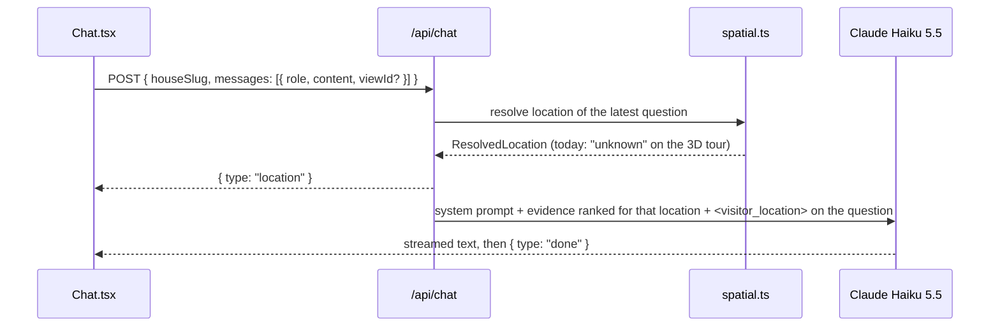

# LLM Layer

How the listing chat works: where house context lives, how it reaches Claude, and how location awareness fits in.

**Current state:** one house, the Seven Park unit (`house-3`), shown as a **full-screen 3D tour** with the chat floating over it. The tour is **walk-only**. The chat answers from the house's context but is **not location-aware yet**: no location is sent, so every question resolves to "location unknown" and the model answers about the whole home. The location pipeline (zones, resolution, ranking, prompt rules) is built and waiting for the camera pose (see [Adding location to the 3D tour](#adding-location-to-the-3d-tour)).

> Earlier versions had two photo-slideshow houses where the current photo stood in for the camera position. They were removed in the UI revamp; git history has them if you need them.

## Where things live

| File | What it does |
|---|---|
| `llm/src/houses.ts` | **All house data.** `zones` (named areas), `scene` (3D tour URLs and credit), `facts`, and `documents` whose sections are tagged with zone IDs. |
| `llm/src/types.ts` | `House`, `HouseScene`, `Zone`, `HouseView`, `ListingFact`, `SourceDocument`, `DocumentSection`, mirroring the blueprint's tables. |
| `llm/src/spatial.ts` | **Spatial resolution.** `resolveView()` turns a view into a `ResolvedLocation`; `zoneRelevance()` scores zones for ranking evidence. `resolvePose()` goes here next. |
| `llm/src/context.ts` | `SYSTEM_PROMPT` (voice, location rules, ground rules), `buildHouseContext()` (evidence ranked by location), `formatLocation()` (the per-message location block), `sourceLabels()`. |
| `llm/src/claude.ts` | `streamChatAboutHouse()`: resolves location, builds the prompt, streams from `claude-haiku-5-5`. |
| `apps/web/src/app/api/chat/route.ts` | `POST /api/chat`: validates the request and streams NDJSON back. |
| `apps/web/src/app/house/[slug]/page.tsx` | House page (server). Passes only the scene, title and source labels to the client; facts and documents never reach the browser. |
| `apps/web/src/app/house/[slug]/HouseExperience.tsx` | Full-screen layout: the tour, the title overlay, and the floating chat (hideable; the conversation is kept while hidden). Pauses the viewer's keyboard input while the chat box has focus. |
| `apps/web/src/app/house/[slug]/SplatViewer.tsx` | Embeds `engine/supersplat-viewer` with `createViewer({ ui: false })`. Loading bar, walk-only enforcement, Reset position, hint and credit. Destroys the viewer on unmount. |
| `apps/web/src/app/house/[slug]/Chat.tsx` | Chat panel. Streams answers and renders citations as chips. Still supports a `currentView` for location-aware tours. |
| `apps/web/public/scenes/` | Viewer settings per scene (camera start, background). The scene content streams from its host. |

## The 3D tour

- **Viewer:** your friend's fork of PlayCanvas's SuperSplat viewer, in `engine/supersplat-viewer`. It's built with `pnpm viewer:build` and linked into `apps/web` as `@playcanvas/supersplat-viewer`. Its built-in UI is off, so the product's own controls are in `SplatViewer.tsx`.
- **Walk-only:** once the scene is loaded and walking is allowed (that needs the collision data), the viewer is put in walk mode. If anything switches it away (the viewer's `1`/`2`/`3`/`Esc` shortcuts, say), it's put straight back. Visitors click or tap a spot to walk there, drag to look, and use WASD to move. Reset position returns to where walking started.
- **Typing in the chat:** the viewer listens for keys on the whole page, so `state.inputEnabled` is switched off while the chat box has focus.
- **Seven Park scene:** streamed from superspl.at's CDN, as in `engine/scripts/fetch-sample.sh`. It's copyrighted, so it's never copied into the repo, and the demo depends on that CDN being up.

## Request flow



## Spatial context (built, waiting for the camera)

### Zones

Zones follow the blueprint's `spatial_zones`, minus the bounding boxes for now. Each has an `id`, `name`, `kind` (`room`, `feature`, `appliance`, `floor`, `outdoor_area`), an optional `parentId`, and `aliases`. House 3 has a living room, balcony, kitchen, primary bedroom and primary bathroom. Document sections list the zones they're about in `zones`; an empty list means the whole home.

### Resolution (`spatial.ts`)

Location is worked out in code, never by the model, and returned as the blueprint's `ResolvedLocation`:

```ts
{
  primaryZone: { id: "kitchen", name: "Kitchen", kind: "room" },
  ancestorZones: [...],     // containing zones, innermost first
  nearbyZones: [...],       // zones in view
  confidence: 1,
  resolution: "inside-zone" // or "unknown"
}
```

### Ranking evidence

`buildHouseContext(house, location)` builds `<evidence>`:

1. **Whole-home facts:** always included.
2. **"Where the visitor is now":** document sections for the current zone, best first. `zoneRelevance()` scores 1.0 for the zone itself or anything inside it, 0.7 for zones in view, and 0.3 for containing zones.
3. **"Elsewhere in the home":** everything else.

### What the model sees

Each question starts with a location block (blueprint § "Example answer context"):

```text
<visitor_location>
Currently viewing: Kitchen (room)
Also in view: Kitchen island
Location confidence: high
</visitor_location>
```

With no location, it's `Unknown … answer about the whole home`. The prompt's location rules:
- Use the location only to interpret "here" or "this room".
- Answer "this room" questions from that area's evidence.
- Go by the latest message's location.
- When the location is unknown, answer about the whole home and only ask which area when a question needs it.
- Never describe what's on screen.

## How context switching works

Claude remembers nothing between requests. Each request carries exactly one house's evidence, ranked for that request's location.
- **History lives in the browser** (React state in `Chat.tsx`). The server is stateless.
- **The client can't inject context.** It sends a house name and, optionally, a view ID; the server picks the evidence and works out the location.
- **Edits are live.** Changes to `houses.ts` apply to the next question.

## Citations and source chips

The model ends each factual sentence with a source label in brackets, e.g. `The balcony faces the city. [Realtor amenities form]`. `Chat.tsx` (`splitCitations`) turns those into chips under the answer. Only this house's real labels count (`sourceLabels(house)`); other bracketed text is left alone.

## Streaming protocol

`POST /api/chat` with `{ houseSlug, messages: [{ role, content, viewId? }] }`. Request errors return JSON with a 4xx status. Otherwise the response is `application/x-ndjson`:

| Event | Meaning |
|---|---|
| `{"type":"location","location":{…}}` | Sent first: the `ResolvedLocation` for the latest question. |
| `{"type":"text","text":"…"}` | Append to the answer. |
| `{"type":"replace","text":"…"}` | Replace the whole answer (refusal or empty reply). |
| `{"type":"done"}` | Finished. |
| `{"type":"error","error":"…"}` | Failed mid-stream. |

## Common changes

- **Edit what the assistant knows:** `llm/src/houses.ts`.
- **Add a 3D house:** add a `House` with a `scene` (content, settings and collision URLs, credit) and put its settings JSON in `apps/web/public/scenes/<name>/`.
- **Change the tone or rules:** `SYSTEM_PROMPT` in `llm/src/context.ts`.
- **Change the model:** `CHAT_MODEL` in `llm/src/claude.ts`.

## Adding location to the 3D tour

Everything after "where is the visitor?" already exists. To finish it:

1. **Read the camera pose.** In `SplatViewer`, `viewer.app.root.findByName('camera')` gives `getPosition()` and `forward`. Report it when movement settles (about 250 ms), at most once a second while moving, and just before each question (blueprint `scene.pose.v1`).
2. **Give House 3's zones boxes** (`min`/`max` x, y, z in the viewer's world coordinates). Get them by walking the tour with a small on-screen position readout and noting each room's corners.
3. **Add `resolvePose(house, position)`** in `spatial.ts`: take the smallest enabled box containing the point, fall back to nearby boxes within about 1.5 m, otherwise `unknown`. It returns the same `ResolvedLocation`.
4. **Send the pose with each question** instead of a `viewId`, and show "Viewing: Living room" in the chat header. Add hysteresis so the label doesn't flicker at doorways.
