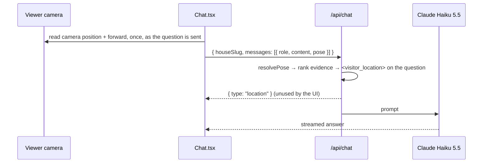

# LLM Layer

How the listing chat works: where house context lives, how the visitor's position in the 3D tour becomes a named location, and how both reach Claude.

**Current state:** one house, the Seven Park unit (`house-3`, at `/singlefloor`), shown as a full-screen walk-through (walk-only, with a Walk / Floor plan switch) with the chat floating over it. The chat is **location-aware**:
- The camera position is mapped to a **room**, and the view ray to the **object** you're facing, such as the kitchen sink, the stove or the shower.
- The direction you face picks out what "this" means.

The location is measured when you ask; the model works out what you mean from it and answers from that spot's evidence first. Customers never see zone names or measurements.

## Where things live

| File | What it does |
|---|---|
| `llm/src/houses.ts` | **All house data.** `zones` (rooms and features with boxes in scene coordinates, plus `opensTo`), `scene` (3D tour URLs and credit), `facts`, and `documents` whose sections are tagged with zone IDs. |
| `llm/src/types.ts` | `House`, `HouseScene`, `Zone`, `Box`, `Vec3`, `ListingFact`, `SourceDocument`, `DocumentSection`. |
| `llm/src/spatial.ts` | **Spatial resolution.** `resolvePose()` turns a camera pose into a `ResolvedLocation`; `zoneRelevance()` scores zones for ranking evidence. No data in it, so the browser can import its types via `@splat/llm/spatial`. |
| `llm/src/context.ts` | `SYSTEM_PROMPT` (voice, location rules, ground rules), `buildHouseContext()` (evidence ranked by location), `formatLocation()` (the per-question location block), `sourceLabels()`. |
| `llm/src/claude.ts` | `streamChatAboutHouse()`: resolves location, builds the prompt, streams from `claude-haiku-5-5`. |
| `apps/web/src/app/api/chat/route.ts` | `POST /api/chat`: validates `{ houseSlug, messages: [{ role, content, pose? }] }` and streams NDJSON back. |
| `apps/web/src/app/[slug]/camera.ts` | `readPose()`: the viewer camera's position and direction. |
| `apps/web/src/lib/pose.ts` | Validates poses from the browser (finite numbers within ±1000). |
| `apps/web/src/app/[slug]/HouseExperience.tsx` | Full-screen layout: tour, title, floating chat. Reads the camera pose for each question. |
| `apps/web/src/app/[slug]/SplatViewer.tsx` | The walk-through, set up as the tours app does it (`web/src/viewer.ts`): `createViewer` with `walkOnly`, the tour's walk feel and floor plan outline/trim/cleanup, built-in UI off. Loading bar, hint, credit. |
| `apps/web/src/components/tour/` | The walk-through (`SplatViewer.tsx`), the Walk / Floor plan switch and Walls slider (`PlanControls.tsx`, `usePlanView`) and `readPose` (`camera.ts`), shared by the house page and the tour settings page. |
| `apps/web/src/lib/tours.ts` | Server-side load / list / save for `apps/web/tours/<name>.json`. |
| `apps/web/src/app/[slug]/admin/` | Dev-only settings page for the home's tour (`/<slug>/admin`): walk feel, look, floor plan outline and cleanup, saved through `app/api/tours`. `/tours` lists the tour files. |
| `apps/web/src/app/[slug]/Chat.tsx` | Chat panel. Sends the pose with each question, streams answers, renders citations as chips. |

## The 3D tour

- **Tour file:** the house names its tour (`scene: { tour: "seven-park" }` in `houses.ts`), and the page reads `apps/web/tours/seven-park.json` on the server. That file holds the content, collision, look, walk feel and floor plan settings, and it's edited on the dev-only settings page (`/singlefloor/admin`).
- **Viewer:** the fork in `engine/supersplat-viewer`, built with `pnpm viewer:build`, in its own **walk-only** mode (`walkOnly: true`) with the tour's walk feel. Visitors click or tap a spot to walk there, drag to look, and use WASD to move.
- **Floor plan:** the **Walk / Floor plan** switch flies up over the floor, and the **Walls** slider cuts the walls down. In the floor plan the camera is overhead, so **chat questions go without a pose**: the location is "unknown" and the model answers about the whole home, asking which room only if the question needs it.
- **Typing:** the viewer listens for keys on the whole page, so `state.inputEnabled` is switched off while the chat box or the plan bar has focus.
- **Seven Park scene:** streamed from superspl.at's CDN (copyrighted; never copied into the repo). The demo depends on that CDN being up.

## How a question gets its location

Location is worked out **only when a question is sent**. Nothing is tracked while you walk.



**Reading the pose:** the viewer has no pose API yet, so `readPose()` reads the engine entity it creates: `viewer.app.root.findByName("camera")`, using its `getPosition()` and `forward`. If the viewer ever renames that entity, this is the one line to update.


## Zones

Zones follow the blueprint's `spatial_zones`. Each has an `id`, `name`, `kind`, `parentId` and `aliases`, plus boxes in the scene's world coordinates (metres, y up, floor at y = 0), written `area(x0, x1, z0, z1)` in `llm/src/houses.ts`.

| Kind | Box field | What the box is |
|---|---|---|
| **room** / **outdoor_area** | `boxes` | The floor area you stand in. Several boxes make an L-shape (the primary bedroom plus its walk-in closet). |
| **entrance** | `boxes` | A doorway. Resolved by **position only**: standing in it puts you "at the entrance", whichever way you face. |
| **feature** / **appliance** | `target` | **The object itself, with its real height.** The camera's 3D view ray is cast against these. |

**`opensTo`** on a room lists the rooms you can see into (open plan or a doorway). It stands in for line-of-sight, so nothing in a room behind a wall counts. One side is enough; it's treated as symmetric.

House 3:

```text
Kitchen          → Sink, Stove (back counter); Oven range, Stove (main run), Tall cabinets; Back counter, Main counter run
Dining area      → Dining table
Living room      → TV (above) / Media shelf (below), Couch, Balcony door, Storage closet
Hallway
Second bathroom  → Shower, Toilet, Sink & mirror · Entrance
Second bedroom   → Bed, TV (above) / Dresser (below), Nightstand, Closet, Balcony door · Entrance
Primary bedroom  → Bed, TV (above) / Dresser (below), Nightstand, Balcony door, Closet (incl. the walk-in closet) · Entrance
Primary bathroom → Shower, Toilet, Sink & mirror · Doorway
Balcony          (the whole south side)
Open: kitchen–dining–living–balcony, dining/living–hallway–second bedroom & bathroom,
      living–primary bedroom–primary bathroom, both bedrooms–balcony
```

**Where the boxes came from:**
- **Room boxes:** read off the scene's walk-mode collision data (`scene.voxel.json` / `.bin`, a sparse voxel tree at 5 cm), decoded and drawn as a top-down height map of walls, counters and furniture.
- **Object boxes:** from a walkthrough log made with the camera readout. Each line is a position, a heading and "<thing> in <room>". Each logged view ray was cast across the collision voxels, and the target box sits on the object it hit (a 0.95 m counter, a 0.6 m TV console, a 0.1 m shower tray…). Objects logged at the same spot but looking up vs down ("TV" / "Shelf") became two stacked objects split by height, using the voxel heights there (the shelf top is ≈ 0.75 m, the TV is above it). The logger now records pitch too, so future logs capture up/down.
- **Entrance boxes:** sit on the logged doorway positions.

Replaying the 32-line log through the 3D resolver (the log predates pitch logging, so each entry is swept from +15° to −60°): **31 entries reach the object they name** at a natural tilt. The other one stands in the primary bathroom's doorway while labelled "in primary bedroom", and resolves to "Primary bathroom · Doorway → Closet". A relog with pitch would check each at its real angle.

## Resolution (`resolvePose`) and how "this" gets decided

**The code measures; the model decides.** `resolvePose` turns the pose sent with a question into measurements. The model weighs those against the question's wording to work out what "this" means.

**Measurements:**
1. **Where you are**, from x/z:
   - the entrance whose doorway box you're in;
   - else the smallest room box containing you;
   - else the nearest room within 1.5 m (`near-zone`);
   - else `unknown`.
2. **Tilt:** looking up, level, or down N°.
3. **Line of sight:** every object box the 3D view ray passes through, in order, with distance along the ray (up to 4 hits, within 8 m).
4. **Around you:** objects within 3 m, nearest first, each with its distance and a **direction relative to your heading** (ahead, ahead-left, left, behind-right, behind…).

Steps 3 and 4 only consider rooms you can actually see into:
- your room;
- its **open-plan** neighbours (`opensTo`: kitchen ↔ dining ↔ living room, dining ↔ hallway, the balcony through the glass);
- when you're standing **in a doorway**, the rooms on both sides of it (room boxes touching the doorway box).

Rooms behind a door don't leak through walls.

**How the model weighs them** (the location rules in `SYSTEM_PROMPT`):
- the first line-of-sight hit is the middle of your view;
- closer is likelier;
- ahead beats beside, and behind is unlikely;
- your own room beats the next one;
- tilt suggests low or eye-height things;
- **the question's own words win** ("is this sofa included?" means the sofa, wherever you're looking);
- if two candidates are equally likely and the answers would differ, it says what it assumed or covers both in a sentence;
- it never mentions rays or measurements.

**Every object has its real height** (`obj(x0, x1, z0, z1, bottom, top)`), so the line of sight behaves like real sight:
- **Looking level** (eye ≈ 1.55 m) hits upper cabinets, tall cabinets, the oven column, closets, TVs, mirrors, showers and glass, and passes **over** low furniture to whatever is behind it.
- **Looking down** hits low things: beds and the couch from about −20°, the sink from −25°, stoves from −30°, and nightstands or the shelf under a TV from about −40°.
- **Kitchen runs** are two boxes each: the base to 1.0 m, and upper cabinets from 1.45 m, set back.

## Ranking evidence

`buildHouseContext(house, location)` builds `<evidence>`:
1. **Whole-home facts:** always included.
2. **"Where the visitor is now":** sections for relevant zones, scored as follows, best first:
   - **1.0** for the first line-of-sight hit, and **0.95** for the others it passes through.
   - **0.9 to 0.75** for objects around you, by distance.
   - **0.8** for the room or doorway you're in, and everything in it.
   - **0.7** for the room around a doorway.

   Every candidate the model might pick has its evidence near the top.
3. **"Elsewhere in the home":** everything else, so whole-home questions work from anywhere.

Each section ends with its source label in brackets, the same shape as the facts lines. Putting the label in the heading led the model to cite the heading.

## What the model sees

The latest question starts with:

```text
<visitor_location>
In: Living room (room)
Looking: level
Line of sight hits: nothing (a bare wall, the floor or the ceiling)
Around them: Media shelf 0.2 m behind-left; TV 0.6 m behind-left; Couch 0.6 m ahead; Dining table (Dining area) 1.9 m behind-right; ...
Location confidence: high
</visitor_location>
```

Objects in another room carry that room's name, since several share a name (Bed, Closet, Balcony door). Earlier questions get a one-line version: `Was in: Kitchen, line of sight on Sink`.

## Tested behaviour (real API, poses from the walkthrough log)

| Where | Question | Answer |
|---|---|---|
| Kitchen aisle, 35° down at the sink | "What is this?" | The undermount sink on the back counter, dishwasher beside it. |
| Same spot, looking level | "What is this?" | The back counter and its upper cabinets. |
| Second bedroom, level over the bed | "What's that over there?" | "You're looking at the closet… along the wall behind the bed." |
| Back counter, facing the stove | "What kind of stove is this?" | 30-inch induction stovetop with a hood. |
| Living room by the couch, looking level (line of sight hits nothing) | "What is this?" | "I'm guessing you mean the couch just ahead of you…", with the shelf behind mentioned only as an aside. |
| Same spot | "Is this sofa included?" | Answers about the sofa: the question's wording wins. |
| Second bedroom, looking level over the bed at the closet | "Is this bed included?" | Answers about the bed, not the closet the line of sight lands on. |
| Living room TV spot, looking level | "What is this?" | The TV wall, "hanging above the media shelf". |
| Same spot, looking down | "What is this?" | The floating media shelf below the TV. |
| At the back-counter stove | "Is there a second stove?" | Yes, on the main run beside the oven range. |
| Second bathroom, facing the shower | "What's the shower like?" | Glass-enclosed shower. |
| Bathroom doorway, facing the closet | "Tell me about this" | The walk-in closet. |
| Second bedroom, facing the balcony door | "Can I walk out there?" | Yes, its own sliding door to the balcony. |
| At the couch | "Is this included?" | No, it's virtual staging. |
| Primary bedroom doorway | "Where am I?" | "By the entrance, with the bed in front of you". |

## Adding or fixing zones

Zones live in `llm/src/houses.ts` (`zones` on the house): rooms and doorways use `boxes: [area(x0, x1, z0, z1)]`, objects use `target: [obj(x0, x1, z0, z1, bottom, top)]`.
1. Get coordinates in the scene's x/z (metres; the camera starts in the dining area facing +z).
2. Add or edit the zone. A new zone needs an `id`, `name`, `kind` and, for an object, `parentId`; a new room may need `opensTo`.
3. For a new object, add a document section tagged with its zone ID, so "this" questions have something to answer from.

The zone-authoring tools used to map House 3 aren't in the customer build. They were an on-screen camera readout (position, heading, pitch), a walkthrough logger exporting a `.txt`, and a debug strip showing what the model received. They're in git history at commit `e061e9e`, and the original log is in `docs/zone-logs/`.

## Listing content (House 3)

All fictional. Each document is a source the model cites (chips in the chat), and every section is tagged with the zones it's about, so "this" questions pull the right one.

| Source | What's in it |
|---|---|
| Listing facts | Price, beds/baths, 960 sq ft interior, 110 sq ft balcony, year, parking, HOA, countertops, appliance package. |
| Realtor amenities form | Room-by-room and object-by-object descriptions, a staging note (furniture isn't included), the layout. |
| **Floor plan & dimensions** | Room sizes and object sizes, from the zone boxes, so they match the 3D scene. Examples: kitchen 12′6″ × 8′8″, primary bedroom 11′6″ × 12′8″ (fits a king), 60″ double vanity, 60 × 36″ shower. |
| **Appliance & fixture schedule** | Makes and product lines: Bosch Benchmark and Miele 30″ induction cooktops, a Bosch 800 Series wall oven and dishwasher, a Kraus sink, a Kohler faucet, Hansgrohe/Kohler/TOTO/Grohe bath fixtures, Lutron shades, a Carrier heat pump. **Product-line names only, no SKUs or model numbers**, so no invented specs get pinned on a real product. |
| HOA documents, seller disclosure, neighborhood guide | Fees and rules, systems and warranty, nearby distances. |

## Citations, streaming and context switching

- **Citations:** the model ends factual sentences with `[Source label]`, and `Chat.tsx` turns those into chips. Only this house's real labels count (`sourceLabels(house)`).
- **Streaming:** `/api/chat` returns NDJSON events:
  - `location` (sent first);
  - `text` (append) and `replace` (swap the whole answer);
  - then `done` or `error`.

  Request errors are JSON with a 4xx status.
- **Context switching:** Claude remembers nothing between requests. Each request carries one house's evidence, ranked for that question's location. History lives in the browser. The client sends only a house name and poses; the server picks the evidence. Edits to `houses.ts` apply to the next question.
