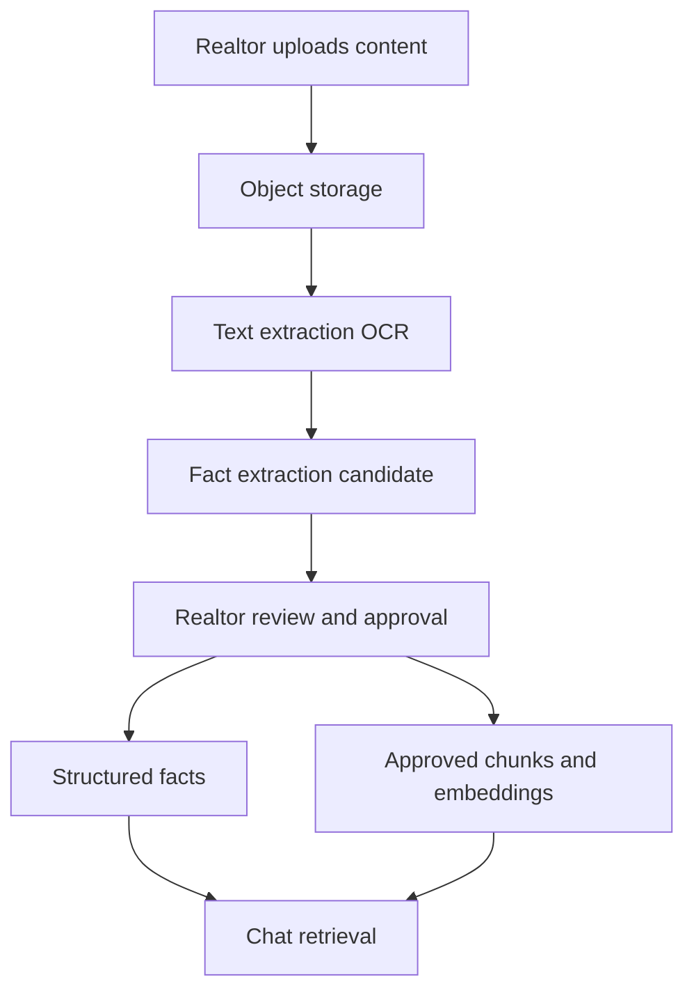

# Spatial Property AI Platform Blueprint

## Purpose

This document defines a technical and product blueprint for a real-estate website where visitors explore a walkable 3D Gaussian-splat property scene and ask an AI assistant questions about the listing. It focuses on the AI, data, and spatial-context layers rather than the renderer itself.

The central product promise is simple: a visitor can stand in the kitchen, ask “What are these counters made of?” and receive a useful, grounded answer that knows they are near the kitchen island. The answer must be based on realtor-supplied facts and approved documents, not invented from the visual scene or generic web knowledge.

This is an implementation-oriented specification. It is intended to give a coding agent enough context to scaffold the application, select services, create the core schema, and build the first vertical slice.

## Product Definition

### The visitor experience

1. A visitor opens a listing page with a 3D splat scene.
2. They can orbit, fly, or, when voxel collision has been generated, walk through the property.
3. A chat panel is always available, optionally showing a subtle location label such as `Kitchen · Island`.
4. They ask natural-language questions, including questions about the home, appliances, neighborhood, renovations, fees, and details near their current location.
5. The assistant answers from approved property facts and uploaded source material. It cites the source or clearly says when the information is unavailable.
6. If the visitor asks a location-sensitive question, the answer uses the camera’s current spatial zone. Example: `Does this room have heated floors?` resolves “this room” to the current room rather than guessing.

### The realtor experience

1. The realtor creates a listing and uploads a splat plus property documents.
2. The platform processes the splat into a web-delivery format and optional collision asset.
3. The realtor fills in structured property facts.
4. In a spatial annotation mode, the realtor draws named 3D regions such as Kitchen, Kitchen Island, Primary Bedroom, Laundry Closet, and Patio.
5. The realtor attaches notes and evidence to each zone when appropriate.
6. The realtor previews the assistant, corrects any extracted facts, and publishes the experience.

### Non-goals for the MVP

- The assistant should not infer a material, appliance model, condition, or room purpose just from a splat image.
- The system should not attempt a full semantic reconstruction of every property automatically.
- The system should not make legal, lending, inspection, appraisal, or fair-housing determinations.
- The system should not rely on the model to understand raw XYZ coordinates.

## Core Design Principles

### Spatial context is deterministic

Coordinates are software data, not language. The application, not the model, resolves a camera pose to a zone. The LLM receives a compact semantic result such as `Kitchen → Island`, plus a confidence value and nearby zones.

### Retrieval is scoped and cited

Every retrieval operation is filtered to the active listing and the current published listing version. When the assistant states a factual claim, the user should be able to see its source: a structured field, realtor note, listing document, or approved public data source.

### Structured facts beat embeddings

Price, bedrooms, bathrooms, square footage, appliances, HOA fees, date built, and listing status are database fields. Documents and prose are used for supplementary evidence. Do not let a semantic search result become the source of truth for critical listing facts.

### Human review creates trust

Extraction can accelerate onboarding, but the realtor or brokerage must confirm extracted facts before publication. A review queue is a product requirement, not a later polish item.

### Scene versions are immutable

A replacement scene can have a new transform, scale, coordinate frame, and collision result. Spatial annotations created against one scene version must never silently apply to another. Every spatial entity carries `scene_version_id`.

### The assistant admits uncertainty

If information is absent, conflicting, out of date, or not source-backed, the assistant should say so and provide a natural next step: “I don’t have a verified answer for that. You can ask the listing agent.”

## Recommended Technology Stack

| Layer | Recommendation | Why |
|---|---|---|
| Frontend and BFF | Next.js with TypeScript | Listing pages, upload dashboard, APIs, server rendering, and chat can share one codebase. |
| Monorepo | pnpm workspaces plus Turborepo | Reusable domain types across web, API, worker, and viewer integration. |
| Scene viewer | Self-hosted fork or wrapper of `@playcanvas/supersplat-viewer` | Full control over deployment and the ability to emit trusted live camera pose events. |
| Primary database | PostgreSQL | Reliable transactional data for listings, users, roles, source records, and chat audit logs. |
| Spatial and vector extensions | PostGIS plus pgvector | Store zone geometry and listing-scoped semantic vectors in one governed database. |
| Object storage | Cloudflare R2 or Amazon S3, fronted by a CDN | Large scene files, collision pairs, images, PDFs, and derived assets should not live in the application filesystem. |
| Background jobs | Redis plus BullMQ | Document parsing, embedding, splat conversion, voxelization, thumbnails, and AI extraction are asynchronous. |
| Processing worker | Dedicated Node worker; containerized GPU-capable worker for splat jobs | Keep long-running scene and document work away from request handlers. |
| LLM | OpenAI Responses API | Modern API surface for grounded responses and structured outputs. Keep application state in the platform database. |
| Observability | Sentry plus structured logs and OpenTelemetry-compatible traces | Trace answer quality, retrieval failures, job failures, and scene-version mismatches. |
| Authentication | Clerk, Auth.js, or Supabase Auth | Support visitors, realtors, brokerage admins, and internal review roles. |

### Why this is the recommended shape

This architecture is intentionally boring in the best way: TypeScript dominates the product surface, Postgres owns the business data, object storage owns large files, and a worker owns expensive processing. It avoids introducing a separate vector database, separate graph database, or agent platform before there is evidence they are needed.

Start with pgvector. Move to a managed vector store only if scale, multi-region latency, or hybrid-search demands make that decision necessary. The core rule remains the same: vectors must be filterable by tenant, listing, and published version.

## SuperSplat Integration Strategy

### Use the viewer as a component you own

The SuperSplat Viewer is a static web application that can be self-hosted and configured with content and Experience Settings. Treat it as a scene runtime, not as the source of truth for your listing platform.

Do not use an opaque cross-origin public SuperSplat iframe for the final product. An iframe is acceptable for a fast visual prototype, but it is the wrong foundation for location-aware chat because the parent application needs a trustworthy stream of camera pose data. Self-host the viewer under the same product domain or package it as a dedicated route such as:

```text
https://app.example.com/viewer/<scene-version-id>
```

The viewer loads the corresponding splat, settings, and collision asset from signed or CDN-backed URLs.

### Viewer bridge contract

Add a narrow integration module at the viewer boundary. Its job is to emit the camera pose and receive optional commands. Keep it versioned and small so viewer upgrades do not spread through the application.

```ts
type ViewerPoseEvent = {
  type: 'scene.pose.v1';
  sceneVersionId: string;
  position: [number, number, number];
  forward: [number, number, number];
  mode: 'orbit' | 'fly' | 'walk';
  timestampMs: number;
};

type ViewerCommand =
  | { type: 'scene.focus-zone.v1'; zoneId: string }
  | { type: 'scene.teleport.v1'; position: [number, number, number]; target?: [number, number, number] }
  | { type: 'scene.highlight-zone.v1'; zoneId: string; enabled: boolean };
```

Emit pose events only when useful:

- immediately when the chat opens;
- after movement has settled for roughly 150–300 ms;
- at a low maximum cadence, such as once per second while moving;
- immediately before the chat request is submitted.

Never emit a message per render frame. The 3D viewer may run at 60+ FPS, while location context changes much more slowly.

### Coordinate-frame rule

Author zones in the same world coordinate frame used by the self-hosted viewer. This is the only coordinate frame the product should expose in its APIs. Do not store zones in a raw-source PLY frame and transform them ad hoc in the chat request.

Persist a coordinate-system descriptor with each scene version:

```ts
type SceneCoordinateSystem = {
  sceneVersionId: string;
  units: 'meters';
  axisConvention: 'viewer-world-v1';
  sourceTransform: number[]; // 4x4 matrix only if a conversion is needed for provenance
  authoritative: true;
};
```

If a new splat replaces an existing scene, create a new scene version. Do not assume existing zones are still correct, even if the home is the same.

### Collision’s role

Voxel collision enables navigation constraints and a walk mode. It is not the data source for conversational location. Use it for the physical experience, but use realtor-authored zones for semantic meaning.

The raw output of collision processing may be useful for optional future features such as validating that a zone sits in reachable space, but it should not be the primary room-classification technique.

## Data Model

The following conceptual schema is sufficient for an MVP and allows the platform to grow without a migration rewrite.

### Tenant and identity entities

```sql
organizations (
  id uuid primary key,
  name text not null,
  created_at timestamptz not null
);

users (
  id uuid primary key,
  auth_subject text unique not null,
  email text not null,
  display_name text,
  created_at timestamptz not null
);

organization_memberships (
  organization_id uuid references organizations(id),
  user_id uuid references users(id),
  role text check (role in ('admin', 'realtor', 'reviewer')),
  primary key (organization_id, user_id)
);
```

### Listing and scene entities

```sql
listings (
  id uuid primary key,
  organization_id uuid not null references organizations(id),
  slug text unique not null,
  status text not null check (status in ('draft', 'review', 'published', 'archived')),
  title text not null,
  address_line_1 text,
  city text,
  region text,
  postal_code text,
  country_code char(2),
  published_scene_version_id uuid,
  created_at timestamptz not null,
  updated_at timestamptz not null
);

scene_versions (
  id uuid primary key,
  listing_id uuid not null references listings(id),
  version_number integer not null,
  status text not null check (status in ('uploaded', 'processing', 'ready', 'failed', 'superseded')),
  source_ply_key text,
  delivery_scene_key text,
  settings_key text,
  voxel_json_key text,
  voxel_bin_key text,
  collision_glb_key text,
  coordinate_system jsonb not null,
  processing_metadata jsonb,
  created_at timestamptz not null,
  unique (listing_id, version_number)
);
```

### Structured listing facts

Use explicit typed columns for high-value facts and a provenance-aware facts table for the long tail.

```sql
listing_facts (
  id uuid primary key,
  listing_id uuid not null references listings(id),
  key text not null,
  value_json jsonb not null,
  display_value text,
  status text not null check (status in ('draft', 'approved', 'superseded', 'rejected')),
  source_id uuid,
  reviewed_by uuid references users(id),
  reviewed_at timestamptz,
  valid_from timestamptz,
  valid_to timestamptz,
  unique (listing_id, key, status)
);
```

Example keys: `bedrooms`, `bathrooms`, `interior_sqft`, `lot_sqft`, `year_built`, `hoa_fee`, `parking`, `heating_type`, `countertop_material`, `appliance_brand`, `roof_year`, and `listing_price`.

### Documents and retrieval chunks

```sql
source_documents (
  id uuid primary key,
  listing_id uuid not null references listings(id),
  object_key text not null,
  filename text not null,
  mime_type text not null,
  source_kind text not null check (source_kind in (
    'realtor_upload', 'listing_feed', 'public_record', 'manual_note', 'generated_summary'
  )),
  status text not null check (status in ('uploaded', 'extracting', 'needs_review', 'approved', 'rejected')),
  extracted_text text,
  created_by uuid references users(id),
  created_at timestamptz not null
);

document_chunks (
  id uuid primary key,
  document_id uuid not null references source_documents(id),
  listing_id uuid not null references listings(id),
  scene_version_id uuid references scene_versions(id),
  zone_id uuid,
  content text not null,
  embedding vector,
  page_number integer,
  section_title text,
  metadata jsonb not null default '{}'::jsonb,
  approval_status text not null check (approval_status in ('approved', 'pending', 'rejected'))
);
```

Every chunk carries `listing_id`; all retrieval SQL begins with it. This makes cross-listing leakage substantially harder to introduce.

### Spatial zones

Start with axis-aligned bounding boxes. Add oriented boxes only when real listings prove they are necessary. An axis-aligned box is fast, understandable in a UI, easy to index, and sufficiently accurate for most rooms.

```sql
spatial_zones (
  id uuid primary key,
  scene_version_id uuid not null references scene_versions(id),
  parent_zone_id uuid references spatial_zones(id),
  kind text not null check (kind in ('property', 'floor', 'room', 'feature', 'appliance', 'outdoor_area')),
  name text not null,
  aliases text[] not null default '{}',
  min_x numeric not null,
  min_y numeric not null,
  min_z numeric not null,
  max_x numeric not null,
  max_y numeric not null,
  max_z numeric not null,
  priority integer not null default 0,
  enabled boolean not null default true,
  created_by uuid references users(id),
  created_at timestamptz not null
);

zone_context (
  id uuid primary key,
  zone_id uuid not null references spatial_zones(id),
  content text not null,
  status text not null check (status in ('draft', 'approved', 'superseded')),
  source_id uuid references source_documents(id),
  created_at timestamptz not null
);
```

Examples:

| Parent | Zone | Kind | Notes |
|---|---|---|---|
| Property | Main floor | floor | Covers the first level. |
| Main floor | Kitchen | room | Parent for kitchen features. |
| Kitchen | Kitchen island | feature | Includes counter and seating area. |
| Kitchen | Range | appliance | Links manuals and appliance facts. |
| Property | Covered patio | outdoor area | Links yard and outdoor context. |

### Conversations and answer audit trail

```sql
conversations (
  id uuid primary key,
  listing_id uuid not null references listings(id),
  scene_version_id uuid references scene_versions(id),
  visitor_session_id text not null,
  created_at timestamptz not null,
  last_activity_at timestamptz not null
);

messages (
  id uuid primary key,
  conversation_id uuid not null references conversations(id),
  role text not null check (role in ('user', 'assistant', 'system')),
  content text not null,
  camera_pose jsonb,
  resolved_location jsonb,
  retrieval_trace jsonb,
  model_metadata jsonb,
  created_at timestamptz not null
);
```

Store the retrieval trace with every assistant message: fact IDs, chunk IDs, zone IDs, model identifier, prompt-template version, and policy outcome. This makes quality debugging and correction possible.

## Spatial Resolution Service

### Inputs

```ts
type ResolveLocationInput = {
  sceneVersionId: string;
  position: [number, number, number];
  forward?: [number, number, number];
};
```

### Output

```ts
type ResolvedLocation = {
  sceneVersionId: string;
  primaryZone?: {
    id: string;
    name: string;
    kind: 'room' | 'feature' | 'appliance' | 'outdoor_area';
  };
  ancestorZones: Array<{ id: string; name: string; kind: string }>;
  nearbyZones: Array<{ id: string; name: string; kind: string; distanceMeters: number }>;
  confidence: number;
  resolution: 'inside-zone' | 'near-zone' | 'unknown';
};
```

### Resolution algorithm

1. Validate the scene version and coordinate frame.
2. Find every enabled zone whose bounding volume contains the camera position.
3. Prefer the smallest matching volume; break ties by explicit priority.
4. Build the zone’s ancestors: feature → room → floor → property.
5. If nothing contains the point, find nearby zones within a small configurable radius, such as 1.5 meters.
6. Return `unknown` rather than an uncertain room guess when the point is outside meaningful bounds.

Feature zones are usually more specific than room zones. A visitor standing in the kitchen island box should resolve to `Kitchen island`, with `Kitchen` as an ancestor. A visitor in open kitchen space should resolve to `Kitchen`.

### Hysteresis and boundary behavior

Camera positions near doors and walls can jitter between regions. To prevent a chat header from flickering:

- retain the last primary zone until the new zone has been stable for 300–500 ms;
- use a small margin around zones for display only;
- preserve the exact unmodified camera pose in the audit trace;
- never use display hysteresis to change database geometry or retrieval authorization.

### Zone authoring UX

The MVP editor should let a realtor:

1. Enter zone-edit mode.
2. Choose a zone kind and parent.
3. Drag a box over the desired volume using handles.
4. Name the zone and add aliases.
5. Add verified notes, select linked documents, or attach facts.
6. Preview “visitor is here” behavior with a movable camera marker.
7. Publish the zone revision.

Later improvements:

- snap room boxes to collision planes;
- create zones from an imported floor-plan model;
- support oriented boxes and polygon footprints;
- generate starter zones with a vision-assisted workflow, always requiring approval;
- add “take me to the kitchen” commands that teleport to a stored safe camera pose.

## Knowledge Ingestion Pipeline

### Supported sources

- Realtor-entered forms
- Listing descriptions and MLS exports, where contractually permitted
- Seller disclosures
- Appliance manuals and model documents
- Inspection reports, only when the owner explicitly permits them
- Renovation invoices and feature sheets
- Property-specific neighborhood notes
- Approved public records, with source and freshness metadata

### Processing flow



### Ingestion requirements

1. Store the original file unchanged in private object storage.
2. Extract text and preserve page/section references.
3. Split prose into semantically coherent chunks; do not split a sentence across chunks when avoidable.
4. Generate candidate facts with source pointers and confidence, but do not automatically publish them.
5. Let the realtor approve, edit, reject, or mark a fact as superseded.
6. Generate embeddings only for approved chunks.
7. Attach zone tags when a realtor explicitly maps content to a room or feature. For example, an appliance manual can be attached to the `Range` zone.

### Document chunk metadata

```json
{
  "listingId": "...",
  "documentId": "...",
  "sourceKind": "realtor_upload",
  "approvalStatus": "approved",
  "zoneIds": ["kitchen", "range"],
  "pageNumber": 4,
  "sectionTitle": "Care and Cleaning",
  "createdAt": "2026-11-14T00:00:00Z"
}
```

### Separate property and neighborhood knowledge

Keep neighborhood material in a distinct source category. It changes faster, has more compliance risk, and may be shared across listings. A neutral guide can include transit, parks, public services, and distance-based amenities, but it should not make demographic or lifestyle suitability claims.

## Retrieval and Answering Pipeline

### Request lifecycle

1. The client sends the question, listing ID, scene version ID, and current camera pose.
2. The API authenticates the user/session and confirms that the listing and scene version are published and accessible.
3. The Spatial Resolution Service produces a semantic location context.
4. The system fetches approved structured facts relevant to the question and location.
5. The system retrieves approved document chunks with hard filters: organization, listing, status, and optionally matching zone IDs.
6. The system ranks the evidence with a blend of semantic relevance, zone match, source authority, and recency.
7. The LLM receives a compact policy prompt, the question, current location, structured facts, and retrieved excerpts.
8. The answer is validated against a JSON schema, persisted with source IDs, then streamed to the client.

### Retrieval ranking

Do not blindly take the highest vector similarity. Score evidence using a weighted combination:

```text
score =
  semantic_similarity * 0.50 +
  zone_match * 0.20 +
  source_authority * 0.20 +
  recency * 0.10
```

This is a starting heuristic, not a permanent formula. Log component values and evaluate them on a test set.

Source authority should normally rank as:

1. Approved structured listing facts
2. Realtor-approved property source documents
3. Official manufacturer documents
4. Approved public records
5. Realtor-authored neighborhood notes

### System instruction requirements

The assistant’s system instructions should require it to:

- answer only from supplied verified facts and retrieved excerpts;
- distinguish an observed location from a verified fact;
- use the visitor location only to interpret deictic language such as “here,” “this room,” or “that appliance”;
- never claim it can inspect the visual scene unless a separate image-analysis capability with explicit evidence is added;
- say when information is missing or uncertain;
- cite the source labels supplied by the application;
- avoid protected-class steering, demographic claims, and suitability recommendations;
- direct legal, financial, inspection, and safety questions to an appropriate professional when needed.

### Suggested response schema

Use structured output internally, then render it in the UI.

```ts
type ChatAnswer = {
  answer: string;
  locationAcknowledgement?: string;
  confidence: 'high' | 'medium' | 'low';
  sources: Array<{
    id: string;
    label: string;
    type: 'listing_fact' | 'document' | 'realtor_note' | 'public_record';
    pageNumber?: number;
  }>;
  suggestedActions?: Array<
    | { type: 'ask_realtor'; label: string }
    | { type: 'focus_zone'; zoneId: string; label: string }
  >;
  policyFlags: string[];
};
```

### Example answer context

```text
Visitor location:
- Current feature: Kitchen island
- Parent room: Kitchen
- Location confidence: high

Verified listing facts:
- Countertop material: quartz. Source: Realtor amenities form.
- Island seating: 4. Source: Realtor amenities form.

Retrieved approved evidence:
[Source A: Realtor amenities form] The kitchen island has quartz counters and seating for four.

User question: What are these counters made of?
```

Desired answer:

```text
The kitchen-island counters are listed as quartz, and the island seats four. [Realtor amenities form]
```

### Follow-up questions

Keep a short window of conversation history, but do not let past messages override current verified data. Each new message should resolve the latest location. For example, if the user says “What about the appliances?” after walking to the laundry area, retrieval should boost laundry appliance evidence rather than kitchen appliances.

## API Design

### Public client endpoints

```text
GET  /api/public/listings/:slug
GET  /api/public/listings/:listingId/scene
POST /api/public/listings/:listingId/location/resolve
POST /api/public/listings/:listingId/chat
```

### Realtor dashboard endpoints

```text
POST /api/listings
POST /api/listings/:listingId/scene-versions/upload-url
POST /api/listings/:listingId/scene-versions/:sceneVersionId/process
POST /api/listings/:listingId/documents/upload-url
POST /api/listings/:listingId/documents/:documentId/ingest
GET  /api/listings/:listingId/facts
PATCH /api/listings/:listingId/facts/:factId
POST /api/scene-versions/:sceneVersionId/zones
PATCH /api/scene-versions/:sceneVersionId/zones/:zoneId
POST /api/scene-versions/:sceneVersionId/publish
```

### Chat request

```json
{
  "conversationId": "optional-existing-id",
  "sceneVersionId": "e171...",
  "question": "What are these counters made of?",
  "cameraPose": {
    "position": [2.12, 1.65, -4.82],
    "forward": [0.76, 0.02, -0.65],
    "mode": "walk"
  }
}
```

### Chat response

```json
{
  "conversationId": "...",
  "location": {
    "primaryZone": "Kitchen island",
    "ancestors": ["Kitchen", "Main floor"],
    "confidence": 0.94
  },
  "answer": "The kitchen-island counters are listed as quartz, and the island seats four.",
  "sources": [
    { "id": "fact_123", "label": "Realtor amenities form", "type": "listing_fact" }
  ],
  "suggestedActions": []
}
```

### Authorization rules

- Public visitors can read only published, public/unlisted listings allowed by the listing owner.
- Listing documents are never directly public by default. The chat service may quote short, approved excerpts without exposing the source file.
- Realtors may access only listings belonging to their organization.
- Brokerage admins can review organization content and audit logs.
- Scene asset URLs should be CDN URLs or time-limited signed URLs; source PLY and original documents remain private.

## Background Jobs

### Job types

| Job | Trigger | Output |
|---|---|---|
| `process_scene` | PLY upload complete | Delivery scene format, preview image, metadata |
| `generate_collision` | Realtor requests walkability | Voxel collision files and optional mesh |
| `extract_document_text` | Document upload complete | OCR/text plus page references |
| `extract_fact_candidates` | Text extraction complete | Reviewable candidate facts |
| `embed_approved_chunks` | Content approval | Embeddings and retrieval records |
| `validate_scene_zones` | Zone publish | Bounds, hierarchy, and overlap warnings |
| `evaluate_answer` | Sampled chat response | Offline quality metrics and regression data |

### Idempotency

Every job must have an idempotency key tied to the source asset version. A retry should not create duplicate chunks, facts, embeddings, or scene versions.

### Failure behavior

Jobs should be observable and recoverable. The dashboard must show human-readable status, last failure reason, retry action, and the exact scene/document version that failed.

## Frontend Product Surfaces

### Listing experience

```text
┌─────────────────────────────────────────────────────────────┐
│ Property title                         Schedule a showing    │
├───────────────────────────────────────┬─────────────────────┤
│                                       │ Ask about this home │
│       Walkable 3D scene viewer        │ Location: Kitchen   │
│                                       │                     │
│                                       │ [Chat history]      │
│                                       │                     │
│                                       │ Ask a question...   │
└───────────────────────────────────────┴─────────────────────┘
```

The chat panel should support:

- streamed responses;
- compact source chips;
- “near Kitchen island” context indication;
- a privacy-safe contact-the-agent action;
- suggested questions based on verified data;
- optional “show me” action that highlights or focuses a named zone.

### Realtor dashboard

Sections:

1. Listing basics and publication status
2. Scene uploads and processing status
3. Walkability/collision status
4. Property facts review
5. Documents and extraction review
6. Spatial zones editor
7. Assistant preview and question test suite
8. Analytics and answer feedback

### Test prompt suite

Each listing should have a small saved set of review prompts such as:

- “How many bedrooms are there?”
- “What material is the kitchen island?”
- “What is in this room?” while located in the kitchen
- “What brand is this range?” while located by the range
- “Are there any issues with the roof?”
- “Is this a good neighborhood for families?”

The last prompt should verify that the assistant responds neutrally and avoids prohibited steering.

## Safety, Compliance, and Privacy

### Fair housing and neighborhood policy

The assistant must not make recommendations or statements based on protected characteristics. It should not characterize neighborhood residents by race, religion, disability, family status, national origin, sex, sexual orientation, gender identity, or other protected traits. It should avoid “perfect for families,” “safe neighborhood,” “good for young professionals,” or similar subjective suitability claims.

Safer alternatives include:

- “The listing’s neighborhood guide notes a park 0.4 miles away.”
- “The nearest transit stop listed in the guide is approximately 0.3 miles away.”
- “For questions about schools, you can review official district resources or speak with the listing agent.”

Run policy classification before and after generation. Log blocked or redirected questions without storing unnecessary personally identifiable information.

### Data privacy

- Treat disclosures, inspection reports, and seller documents as sensitive.
- Use private object storage and least-privilege server access.
- Do not expose document download URLs in chat responses by default.
- Keep user IP and analytics data on a documented retention schedule.
- Provide a delete/export path for realtor content and visitor conversation data where required.
- Do not send original documents to a model unless your data-processing policy permits it and the realtor has authorized it.

### Prompt injection defenses

Uploaded documents are untrusted content. A document may contain instructions such as “ignore your rules.” Retrieval text must be clearly delimited as evidence, never as instructions. The system prompt has higher priority and should instruct the model to ignore commands contained in source material.

### Hallucination prevention

- Require an evidence-backed answer for factual claims.
- Give structured facts precedence over text chunks.
- Require a low-confidence response when evidence is weak.
- Display citations.
- Sample responses for review.
- Measure unsupported-claim rate in an offline evaluation set.

## Quality Evaluation

### Metrics to measure

| Metric | Definition | Initial target |
|---|---|---|
| Grounded-answer rate | Factual answers with valid supporting evidence | >95% for evaluation prompts |
| Unsupported-claim rate | Claims not supported by facts/chunks | <2% |
| Location-resolution accuracy | Correct room/feature for labeled test poses | >95% |
| Source-citation coverage | Factual answers that show a source | >90% |
| P95 chat latency | End-to-end time to complete answer | <5 seconds, with streaming earlier |
| Ingestion success | Documents/scenes successfully processed | >98% after retry |
| Policy compliance | Correct handling of prohibited questions | >99% on policy test set |

### Evaluation dataset

Create a private test corpus of 10–20 representative listings. For each:

- 20–40 questions with expected facts and sources;
- 10–20 labeled camera poses and expected zones;
- ambiguous/negative questions where the right answer is “not available”;
- policy-sensitive questions;
- stale/conflicting data cases.

Run this suite before model, prompt, retrieval, or zone-resolution changes are deployed.

## Delivery Plan

### Phase 0: Foundations

Goal: create a secure, versioned data backbone.

- Create the TypeScript monorepo.
- Set up Postgres, object storage, Redis, authentication, environment management, and observability.
- Implement organizations, users, listings, scene versions, and documents.
- Add immutable audit fields and basic role checks.

### Phase 1: Non-spatial grounded chat

Goal: a realtor uploads facts and documents; visitors get grounded answers.

- Build structured listing-facts form.
- Build document upload and extraction jobs.
- Build realtor approval workflow.
- Implement listing-scoped retrieval.
- Implement chat endpoint, source citations, conversation persistence, and basic policy controls.

Exit criterion: The assistant accurately answers property questions from approved material without a viewer dependency.

### Phase 2: Spatial semantics

Goal: “this room” and “this appliance” work.

- Self-host the viewer and add the pose bridge.
- Add scene-version management.
- Build axis-aligned 3D zone authoring.
- Build the Spatial Resolution Service.
- Pass location context into retrieval and prompts.
- Add zone-specific notes and source tags.

Exit criterion: Test poses resolve to the expected room/feature and improve answers to location-sensitive questions.

### Phase 3: Walkability and guided exploration

Goal: polished property exploration.

- Add voxel generation job flow and status UX.
- Validate scene scale and initial camera location.
- Add focus-zone and teleport actions.
- Show location indicator and contextual suggested questions.

Exit criterion: Visitors can walk, ask, and navigate to relevant features with reliable scene context.

### Phase 4: Production hardening

Goal: operate at brokerage scale.

- Add rate limits, abuse protections, caching, and quota controls.
- Add full evaluation harness and release gates.
- Add analytics, feedback, human escalation, and support tooling.
- Add retry/reprocessing controls and immutable source versioning.
- Review security posture, retention, contracts, and fair-housing policy with counsel.

## First Vertical Slice

Build this before attempting full automation:

1. One listing.
2. One manually uploaded scene version.
3. Five manually drawn zones: entry, kitchen, kitchen island, living room, primary bedroom.
4. Ten manually entered/approved facts.
5. One uploaded appliance manual.
6. Self-hosted viewer emitting pose events.
7. One chat endpoint that resolves a zone, retrieves from Postgres, and returns cited answers.

Demonstrate the following acceptance test:

1. Walk to the island.
2. Ask, “What are these counters made of?”
3. The UI displays `Kitchen island` as location.
4. The assistant says `quartz` only if it is in an approved fact or source.
5. The response cites the source.
6. Ask the same question from the primary bedroom. The assistant can still answer the general property fact, but should not incorrectly imply that the user is near the kitchen.

## Suggested Repository Structure

```text
apps/
  web/                     # Next.js visitor site and realtor dashboard
  worker/                  # BullMQ processors
  viewer/                  # Self-hosted SuperSplat viewer wrapper/fork
packages/
  db/                      # Schema, migrations, query helpers
  domain/                  # Types and business rules
  spatial/                 # Pose validation and zone resolution
  ai/                      # Retrieval, prompts, structured schemas, evaluation
  scene/                   # Scene asset manifests and viewer bridge contracts
  ui/                      # Shared components
infra/
  docker/
  terraform-or-pulumi/
docs/
  architecture/
  adr/
  runbooks/
```

## Architectural Decisions to Record Early

Write lightweight Architecture Decision Records for these choices:

1. Why viewer coordinates are the single authoritative zone frame.
2. Why zones are versioned by scene version.
3. Why Postgres/pgvector is used for the MVP.
4. Why structured facts outrank vector retrieval.
5. Which model provider/API is used and how it is wrapped.
6. What content can be uploaded, retained, embedded, or exposed to visitors.
7. How neighborhood information is sourced and reviewed.
8. What answer categories require an escalation to the realtor.

## Risks and Mitigations

| Risk | Consequence | Mitigation |
|---|---|---|
| Wrong coordinate frame | Chat identifies the wrong room | Author zones in viewer-world coordinates; version every scene. |
| Scene replacement changes scale/pose | Zones drift or become meaningless | New scene version; require review before re-publishing zones. |
| Model invents facts | Loss of trust and compliance exposure | Structured facts, source-scoped retrieval, citations, evaluation, refusal when unsupported. |
| Documents contain sensitive material | Privacy incident | Private storage, approval workflow, limited excerpts, retention policy. |
| Realtor content is incomplete | Weak answers | Surface coverage dashboard and unanswered-question analytics. |
| Zone authoring is too tedious | Low adoption | Begin with simple boxes and templates; later add assisted suggestions. |
| Large splat processing is expensive | Long onboarding and high costs | Background queue, quotas, derived web formats, clear job progress. |
| Fair-housing violations | Legal and reputational risk | Policy prompts, classifiers, test suite, escalation flow, legal review. |

## Decisions Needed Before Production

- Whether listings are public, unlisted, gated behind lead capture, or a mix.
- Which uploads are allowed and who owns them.
- Whether the system connects to MLS/IDX data, and the licensing terms for doing so.
- Whether source documents may be exposed to visitors or only cited.
- Whether neighborhood content comes from realtors, licensed data sources, or approved public sources.
- Retention periods for visitor chats and uploaded documents.
- Whether the platform is brokerage-only, multi-tenant SaaS, or consumer-facing.
- Who is responsible for approving facts and compliance-sensitive content.

## Final Recommendation

Build the AI layer as a grounded, listing-scoped retrieval system with deterministic spatial resolution. The 3D viewer contributes a camera pose; the application turns that pose into a named, realtor-approved zone; the retrieval system selects only authorized property evidence; and the LLM writes a concise, cited answer.

The MVP should favor manual zone authoring and fact review over ambitious automatic scene understanding. That path delivers a trustworthy demo quickly, establishes the right data contracts, and leaves room for future automation without making accuracy depend on it.
